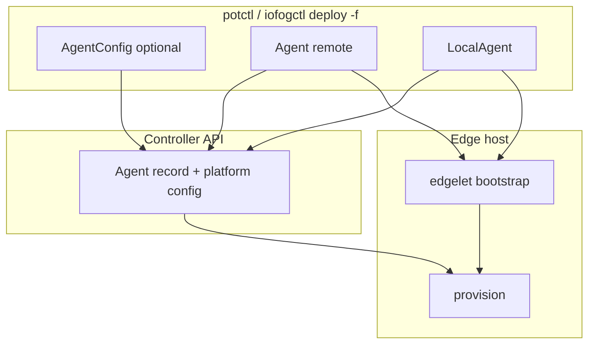

# Agent documentation

These guides describe **deploy YAML** and **operator commands** for ioFog **edge agents** in **potctl** and **iofogctl** (v3.9.x). They cover edgelet installation on hosts, Controller **AgentConfig**, and day-two lifecycle.

## Deploy kinds

| `kind` | Use | Host access |
|--------|-----|-------------|
| [`Agent`](remote/README.md) | Production edge node (SSH) | Remote |
| [`LocalAgent`](local/README.md) | Edgelet on the machine running the CLI | Local |
| [`AgentConfig`](agent-config/README.md) | Controller API agent record only (no edgelet bootstrap) | N/A |

User manifests use **`apiVersion: <group>/v3`**. The group depends on CLI flavor (see below).

**Prerequisite:** A **control plane** must exist in the namespace (`KubernetesControlPlane`, remote `ControlPlane`, or `LocalControlPlane`) before deploying edge agents.

## Mirror flavors (single doc set)

| | **Datasance (potctl)** | **Eclipse (iofogctl)** |
|---|------------------------|-------------------------|
| Deploy YAML `apiVersion` | `datasance.com/v3` | `iofog.org/v3` |
| Default image registry | `ghcr.io/datasance` | `ghcr.io/eclipse-iofog` |
| CLI config directory | `~/.iofog/v3` | `~/.iofog/v3` |

Examples use Datasance registry paths; substitute your flavor’s registry and tags.

## v3.9.x component pairing

Align manifest image tags with the CLI you install:

| Component | Version |
|-----------|---------|
| potctl / iofogctl | `v3.9.0` |
| edgelet (binary / image) | `v1.1.0` / `1.1.0` |
| controller / router / operator | `3.9.0` |

See [control plane pairing](../controlplane/README.md#v39x-component-pairing) for the full stack.

## Architecture overview



Deploy splits **Controller registration** (AgentConfig) from **host bootstrap** (edgelet scripts + provision). See [Deploy sequence](#deploy-sequence).

## Deploy sequence

For **`Agent`** and **`LocalAgent`** in one `deploy -f`:

1. Parse multi-document YAML (strict decode per document).
2. **AgentConfig phase** (before agent kinds run):
   - Explicit `kind: AgentConfig` documents execute against the Controller API.
   - For each `Agent` / `LocalAgent` without a matching AgentConfig, the CLI **synthesizes** AgentConfig from `spec.config` (and agent name / host).
   - Matching is by **`metadata.name`**; explicit AgentConfig executors get **host** and **tags** merged from the agent spec.
3. **Agent / LocalAgent phase:** edgelet bootstrap → optional AgentConfig update if `spec.config` is set → `edgelet config` / `edgelet provision` → persist agent in namespace config under `~/.iofog/v3`.

**Order matters** for `upstreamRouters` and `upstreamNatsServers`: values are **agent names** in YAML; the CLI resolves them to UUIDs at deploy time. Upstream agents must already exist on the Controller (deploy them first or use explicit AgentConfig in the same file before dependents).

### Multi-document YAML

- Namespace: CLI `-n` must match optional `metadata.namespace` on each document.
- One file may contain control plane, agents, volumes, and applications; agent deploy runs only after control plane executors succeed.
- You may omit standalone `AgentConfig` when `spec.config` on the agent is sufficient.

## System agents (control plane hosts)

**System agents are not `kind: Agent`.** They are declared under control plane YAML:

| Control plane | YAML path | Edgelet bootstrap |
|---------------|-----------|-------------------|
| Remote `ControlPlane` | `controllers[].systemAgent` | Once per controller host during CP deploy ([edgelet-bootstrap.md](edgelet-bootstrap.md)) |
| `LocalControlPlane` | `spec.systemAgent` | Once on the local CP host during CP deploy |

Bootstrap runs when each **control-plane host** is prepared (`DeployHostEdgelet` / local equivalent). The follow-on system-agent step only pushes **AgentConfig** to the Controller and runs **provision**—it does **not** run bootstrap again.

Document system-agent **config** fields with [agent-config/schema.md](agent-config/schema.md) (interior router / server NATS defaults). Document **scripts** under [`controllers[].systemAgent.scripts`](../controlplane/remote/schema.md) or [local systemAgent](../controlplane/local/schema.md).

Platform reconcile then provisions **`system-{agentName}/router`** and **`system-{agentName}/nats`** from those settings — see [Networking topology](networking/README.md).

## Edgelet bootstrap and custom scripts

Layered install, `spec.scripts`, airgap, and WASM scope:

- [edgelet-bootstrap.md](edgelet-bootstrap.md)

Agent YAML paths: `spec.scripts` on **`Agent`** and **`LocalAgent`**.

## Service distribution tags

To receive **local TCP bridge listeners** for a Controller [Service](../service/README.md), tag the agent (or **AgentConfig**) with the distribution prefix and token — not the bare token alone:

```yaml
metadata:
  tags:
    - "service.iofog.org/tag: checkout"   # matches Service metadata.tags: [checkout]
    - "service.iofog.org/tag: all"        # every Service
```

See [Service distribution](../service/distribution.md). Hub provisioning and edge listener reconcile are separate steps.

## Document map

| Path | Contents |
|------|----------|
| [remote/README.md](remote/README.md) | Remote agent deploy flow |
| [remote/schema.md](remote/schema.md) | Full `Agent` field reference |
| [remote/examples/](remote/examples/) | Sample manifests |
| [local/README.md](local/README.md) | Local agent deploy flow |
| [local/schema.md](local/schema.md) | Full `LocalAgent` field reference |
| [local/examples/](local/examples/) | Sample manifests |
| [agent-config/README.md](agent-config/README.md) | AgentConfig-only deploy |
| [agent-config/schema.md](agent-config/schema.md) | Controller agent configuration fields |
| [agent-config/examples/](agent-config/examples/) | Standalone and multi-doc samples |
| [lifecycle.md](lifecycle.md) | delete, detach, attach, prune, upgrade, reconcile, configure, volumes, offline images |
| [debugging.md](debugging.md) | **`logs agent`**, **`exec agent`**, attach/detach exec, local vs remote behavior |
| [edgelet-bootstrap.md](edgelet-bootstrap.md) | Bootstrap pipeline and custom scripts |
| [Service distribution tags](../service/distribution.md) | `service.iofog.org/tag` for TCP bridge listeners |
| [networking/README.md](networking/README.md) | Router + NATS fabric from agent config → system microservices |
| [networking/router-fabric.md](networking/router-fabric.md) | `routerMode`, TLS, upstream routers |
| [networking/nats-fabric.md](networking/nats-fabric.md) | `natsMode`, leaf/server, JetStream, resolver bundles |

## Common commands

```bash
# Deploy agents (namespace defaults to "default" unless -n is set)
potctl deploy -f agents.yaml -n my-ecn

# Describe stored agent + live status
potctl describe agent my-edge -n my-ecn
potctl describe agent-config my-edge -n my-ecn

# Day-two operations
potctl delete agent my-edge -n my-ecn
potctl detach agent my-edge -n my-ecn
potctl attach agent my-edge -n my-ecn

# Debugging
potctl logs agent my-edge -n my-ecn
potctl exec agent my-edge -n my-ecn
```

Replace `potctl` with `iofogctl` on the Eclipse flavor. See [lifecycle.md](lifecycle.md) for full command coverage and [debugging.md](debugging.md) for logs and exec.
