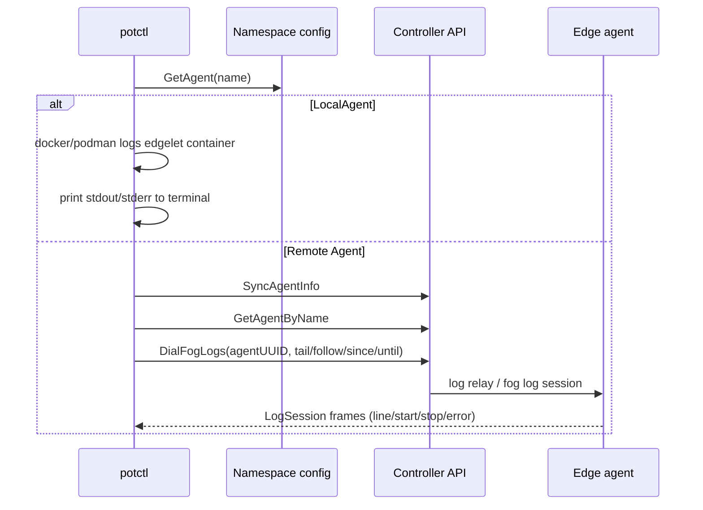
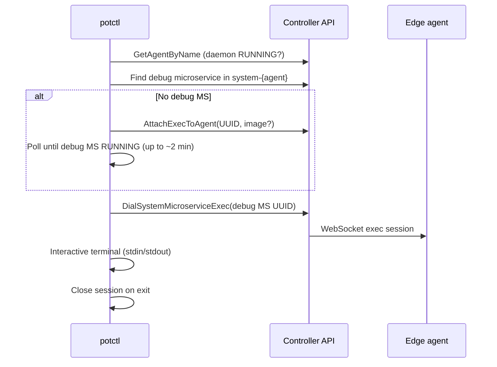

# Agent debugging — logs and exec

Use **`logs agent`** to stream **edgelet / fog daemon logs** and **`exec agent`** to open an **interactive shell** on the edge host via a Controller-managed **debug microservice**.

Both commands need a **namespace** that is connected to a Controller (`connect` or control plane deploy) and an agent **name** known to the Controller.

> **Command name:** the CLI subcommand is **`logs`** (plural), not `log`:
> `potctl logs agent NAME`.

Replace `potctl` with `iofogctl` on the Eclipse flavor.

---

## Prerequisites

| Requirement | `logs agent` | `exec agent` |
|-------------|--------------|--------------|
| Namespace config under `~/.iofog/v3` | Yes | Yes |
| Controller API reachable | Remote agent: yes | Yes |
| Agent registered on Controller | Yes | Yes |
| Agent daemon **RUNNING** | Recommended (remote stream) | **Required** |
| RBAC / auth roles | Controller session | **SRE**-class access for node exec (Controller enforces) |

Sync before remote logs: the CLI calls **`SyncAgentInfo`** so local namespace cache matches Controller agent records.

---

## `logs agent` — edgelet log stream

### Purpose

Tail **agent (fog) daemon logs** — the edgelet runtime on the node — not arbitrary application microservice logs. For workload logs use **`logs microservice AppName/MsvcName`**.

### Syntax

```bash
potctl logs agent AGENT_NAME -n NAMESPACE [flags]
```

### Flags

| Flag | Default | Description |
|------|---------|-------------|
| `--tail` | `100` | Lines to fetch first ( **1–5000** ) |
| `--follow` | **`true`** | Keep streaming new lines |
| `--since` | (empty) | Start time **RFC3339** / ISO 8601 (e.g. `2024-01-01T00:00:00Z`) |
| `--until` | (empty) | End time RFC3339 |

Set **`--follow=false`** for a one-shot snapshot (still subject to remote vs local behavior below).

### How it works



#### Remote agent (`kind: Agent`)

1. Resolve agent UUID from Controller.
2. Open a **WebSocket log session** via SDK **`DialFogLogs`** with tail options.
3. Print **`LogMessageLine`** frames to stdout until **stop**, **error**, or connection end.

The Controller may relay logs across HA replicas; if relay is unavailable you may see messages about **log session relay** or **server draining** — retry or use another controller replica.

#### Local agent (`kind: LocalAgent`)

1. Read namespace-stored **LocalAgent** spec (container engine from agent config).
2. Fetch logs from the local **edgelet container** (`GetLogsByName` on the edgelet container name).
3. Print **stdout and stderr** once to the terminal.

**Important:** **`--tail`**, **`--follow`**, **`--since`**, and **`--until`** apply to the **remote** `DialFogLogs` path. They are **not** passed to the local container engine path today — local `logs agent` is effectively a **full container log dump** from the engine API.

### Examples

```bash
# Follow last 100 lines (default)
potctl logs agent edge-01 -n my-ecn

# Snapshot only, last 500 lines
potctl logs agent edge-01 -n my-ecn --follow=false --tail=500

# Time window (remote)
potctl logs agent edge-01 -n my-ecn --since=2026-01-01T00:00:00Z --until=2026-01-02T00:00:00Z
```

### Troubleshooting

| Symptom | Likely cause |
|---------|----------------|
| Agent not in namespace config | Deploy or `connect` did not persist agent; run `describe agent` |
| Timeout waiting for agent | Agent offline or network path to fog broken |
| Relay / draining errors | Controller HA or rollout — retry |
| Local: empty or error | Edgelet container not running on this machine |

---

## `exec agent` — interactive debug shell

### Purpose

Open a **terminal session** into a **debug container** on the edge node. The CLI connects through the Controller exec WebSocket API to a **system microservice** named like **`debug`**, **`debug-<agentName>`**, or **`debug-<agentUUID>`** under application **`system-<agentName>`**.

This is **node-level debug exec** (SRE), not **`exec microservice`** (Developer workload exec).

### Syntax

```bash
potctl exec agent AGENT_NAME [DEBUG_IMAGE] -n NAMESPACE
```

| Argument | Description |
|----------|-------------|
| `AGENT_NAME` | Controller agent name |
| `DEBUG_IMAGE` | Optional OCI image for the debug container when auto-provisioning |

If omitted, Controller / catalog defaults apply when fog debug exec is provisioned.

### How it works



#### Auto-provision (default path)

**`exec agent`** calls **`ensureDebugExecReady`**:

1. Fail fast if agent **`DaemonStatus`** is not **`RUNNING`**.
2. Look for an existing **debug** system microservice on that agent.
3. If missing → **`AttachExecToAgent`** (same API as **`attach exec agent`**) with optional image.
4. Poll every **2s** (max **60** attempts) until microservice status is **`RUNNING`**.
5. **`DialSystemMicroserviceExecWithOptions`** and hand off to an **interactive terminal** (raw TTY on Unix).

If debug was already provisioned but stopped, the CLI waits for **RUNNING** again.

#### Manual provision (optional)

Provision without opening a shell first:

```bash
potctl attach exec agent edge-01 -n my-ecn
potctl attach exec agent edge-01 ghcr.io/org/debug:1.0 -n my-ecn
```

Then:

```bash
potctl exec agent edge-01 -n my-ecn
```

Remove debug workload when finished:

```bash
potctl detach exec agent edge-01 -n my-ecn
```

**`detach exec agent`** calls **`DetachExecFromAgent`** on the agent UUID and removes the fog debug exec resources.

### Session behavior

- Spinner stops before the interactive session; stdin/stdout attach to the WebSocket exec stream.
- Status lines from the session may print via SDK callbacks.
- Exit closes the session; CLI prints success when the session ends cleanly.
- **Concurrent exec limits:** Controller may return **409** — at most **3** concurrent exec sessions per microservice (message surfaced by CLI).

### Examples

```bash
# Auto-provision debug container if needed, then shell
potctl exec agent edge-01 -n my-ecn

# Custom debug image on first provision
potctl exec agent edge-01 ghcr.io/datasance/debug:latest -n my-ecn
```

### Troubleshooting

| Symptom | Likely cause |
|---------|----------------|
| Agent is not running | Start edgelet / fix agent before exec |
| Timeout waiting for debug container | Image pull failure, agent disk, or catalog/registry |
| Insufficient permissions | User lacks **SRE** (node exec) role on Controller |
| Only SRE for system MS | Expected for system microservice exec path |
| Relay / draining errors | Same HA considerations as logs |
| Debug microservice not found (older flows) | Run **`attach exec agent`** or use **`exec agent`** (auto-provisions) |

---

## Compare: logs vs exec vs microservice logs/exec

| Command | Target | Transport | Interactive |
|---------|--------|-------------|-------------|
| **`logs agent`** | Edgelet / fog daemon | `DialFogLogs` (remote) or local container logs | No (stream to stdout) |
| **`logs microservice`** | App microservice | `DialMicroserviceLogs` / system variant | No |
| **`exec agent`** | Debug system container on node | `DialSystemMicroserviceExec` | Yes (shell) |
| **`exec microservice`** | Running app microservice | `DialMicroserviceExec` | Yes |

---

## Related reading

- [lifecycle.md](lifecycle.md) — attach/detach agent, upgrade, delete
- [remote/README.md](remote/README.md) — SSH deploy and connectivity
- [local/README.md](local/README.md) — LocalAgent and container engine
- Generated reference: [`../../potctl_md/potctl_logs.md`](../../potctl_md/potctl_logs.md), [`../../potctl_md/potctl_exec_agent.md`](../../potctl_md/potctl_exec_agent.md)
