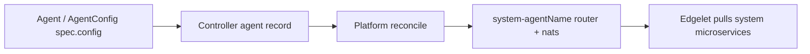

# Agent networking topology

PoT / ioFog is **secure by default**. You declare **router** and **NATS** roles on each edge agent (`Agent`, `LocalAgent`, or **`AgentConfig`**). Controller **platform reconcile** then creates **`system-{agentName}`**, the **`router`** and **`nats`** system microservices, certificate authorities, TLS material, configs, and upstream links. You do not install fabric CAs, write `skrouterd.json` / `server.conf`, or copy JWT bundles by hand.

| Fabric | Agent fields | System microservice | User-facing layer |
|--------|--------------|---------------------|-------------------|
| **Service interconnection** (AMQP router) | `routerConfig`, `upstreamRouters`, `networkRouter` | `system-{agent}/router` | [Service](../../service/README.md) TCP bridges in router `bridges` |
| **Messaging** (NATS) | `natsConfig`, `upstreamNatsServers` | `system-{agent}/nats` | [NATS access](../../workloads/nats-access/README.md), [NATS rules](../../nats-account-rule/README.md) |

Field reference: [AgentConfig schema](../agent-config/schema.md). Deploy flow: [Agent README](../README.md#deploy-sequence).

---

## Declare vs build



1. **potctl deploy** sends configuration (CLI resolves **`upstreamRouters`** / **`upstreamNatsServers`** from **agent names** to UUIDs).
2. Create returns the agent uuid; **provisioning runs in the background**.
3. Controller flags the agent; edgelet applies **`system-{agentName}`** catalog workloads.

Observe system workloads:

```bash
potctl get system-microservices -n my-ecn
potctl describe system-microservice system-plant-a/router -n my-ecn
potctl describe system-microservice system-plant-a/nats -n my-ecn
potctl reconcile agent plant-a -n my-ecn   # retry stuck platform reconcile
```

See [workloads — system applications](../../workloads/README.md#taxonomy--how-pieces-fit-together).

---

## Defaults (typical edge node)

| Setting | Default | Meaning |
|---------|---------|---------|
| `routerConfig.routerMode` | **`edge`** | Workload node; dials interior routers |
| `natsConfig.natsMode` | **`leaf`** | Local NATS; dials hub / servers on `7422` |
| `upstreamRouters` | omit | **default-router** + every system-agent router |
| `upstreamNatsServers` | omit | **default-nats-hub** + every system-agent NATS server |

Examples: [examples/edge-leaf-defaults.yaml](examples/edge-leaf-defaults.yaml).

---

## Control plane: remote vs Kubernetes

| | **Remote / local control plane** | **Kubernetes control plane** |
|---|----------------------------------|------------------------------|
| **First agent** in empty cluster | Becomes **system agent**: Controller forces **`routerMode: interior`** and **`natsMode: server`** (even if YAML asked otherwise) | User **cannot** create a system agent via agent API; **platform router + NATS** are the hub |
| **Hub router / NATS** | First system agent is **`default-router`** and the NATS hub — [remote networking](../../controlplane/remote/networking.md) | Operator Deployment `router` and StatefulSet `nats`, then registered with the Controller API — [Kubernetes networking](../../controlplane/kubernetes/networking.md) |
| **Later agents** | Roles you set (`edge` + `leaf` when omitted) | Usually **edge** + **leaf**; extra **server** agents patch into hub cluster routes |

System agents on control plane **hosts** are configured via [control plane YAML](../../controlplane/README.md) (`controllers[].systemAgent` / `spec.systemAgent`), not user **`kind: Agent`**. See [System agents](../README.md#system-agents-control-plane-hosts). Local control plane uses the remote hub path.

---

## Router and NATS docs

| Document | Contents |
|----------|----------|
| [router-fabric.md](router-fabric.md) | `routerMode`, TLS, listeners, connectors, `bridges` + Service |
| [nats-fabric.md](nats-fabric.md) | `natsMode`, JetStream, server vs leaf, resolver bundles |

---

## ECN CertificateAuthority vs fabric CAs

[CertificateAuthority](../../certificate-authority/README.md) and [Certificate](../../certificate/README.md) under **`docs/operators/`** are **ECN catalog** resources you deploy for workload TLS (ingress, custom apps).

Router and NATS fabric use **separate auto-created CAs** (`router-site-ca`, `default-router-local-ca`, `nats-site-ca`, `default-nats-local-ca`). Controller issues and mounts those during platform reconcile — you do not reference them in agent YAML.

---

## What you do not do by hand

| Manual | Declarative |
|--------|-------------|
| Install router/NATS CAs and issue per-node certs | Set **`routerMode`** / **`natsMode`** and **`host`** |
| Write router JSON or NATS `server.conf` / `leaf.conf` | Change agent config or publish a **Service** |
| Wire upstream router/NATS links | **`upstreamRouters`** / **`upstreamNatsServers`** (or defaults) |
| Copy account JWTs to every NATS node | Application **`natsAccess`** + [NATS access](../../workloads/nats-access/README.md) |
| Open Service TCP bridges in router config | Deploy **`kind: Service`** |

---

## Related documents

- [AgentConfig](../agent-config/README.md) · [remote Agent](../remote/README.md)
- [Kubernetes hub](../../controlplane/kubernetes/networking.md) · [Remote hub](../../controlplane/remote/networking.md)
- [Service](../../service/README.md) · [NATS access](../../workloads/nats-access/README.md)
- [examples/edge-leaf-defaults.yaml](examples/edge-leaf-defaults.yaml) · [examples/interior-node.yaml](examples/interior-node.yaml)
