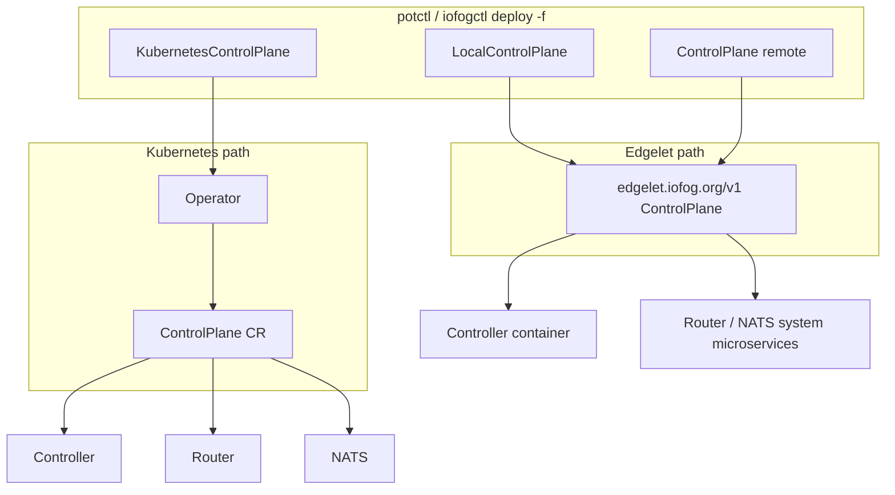

# Control plane documentation

These guides describe **deploy YAML** for control planes in **potctl** and **iofogctl** (v3.9.x). They cover what you put in manifest files, how the CLI validates and deploys them, and how TLS and trust work for operators and integrators.

## Deploy kinds

| `kind` | Typical use | Runtime backend |
|--------|-------------|-----------------|
| [`KubernetesControlPlane`](kubernetes/README.md) | Controller, Router, and NATS on Kubernetes | [ioFog operator](https://github.com/eclipse-iofog/iofog-operator) `ControlPlane` custom resource |
| [`LocalControlPlane`](local/README.md) | Single-node dev / test on this machine | [Edgelet](https://github.com/Datasance/edgelet) `edgelet.iofog.org/v1` `ControlPlane` |
| [`ControlPlane`](remote/README.md) | Production multi-host control plane | Edgelet on each `spec.controllers[]` host |
| [`Controller`](remote/controller-add-on.md) | Add another controller host to an existing remote CP | Same Edgelet path; uses stored CP spec |

All user manifests use **`apiVersion: <group>/v3`**. The group depends on CLI flavor (see below). **`metadata.controlPlaneType` is retired** — use the `kind` field only.

## Mirror flavors (single doc set)

Go module and YAML shapes are the same; build-time defaults differ.

| | **Datasance (potctl)** | **Eclipse (iofogctl)** |
|---|------------------------|-------------------------|
| Deploy YAML `apiVersion` | `datasance.com/v3` | `iofog.org/v3` |
| Operator / CR `apiVersion` | `datasance.com/v3` | `iofog.org/v3` |
| Operator `ControlPlane` CR name (fixed) | `pot` | `iofog` |
| Default image registry | `ghcr.io/datasance` | `ghcr.io/eclipse-iofog` |
| CLI config directory | `~/.iofog/v3` | `~/.iofog/v3` |

Edgelet manifests are always **`apiVersion: edgelet.iofog.org/v1`**, **`kind: ControlPlane`**. The CLI translates local and remote user YAML into that form.

## v3.9.x component pairing

Align manifest image tags with the CLI you install:

| Component | Version |
|-----------|---------|
| potctl / iofogctl | `v3.9.0` |
| operator | `3.9.0` |
| controller | `3.9.0` |
| router | `3.9.0` |
| nats | `2.15.0` |
| edgelet (binary / image) | `v1.1.0` / `1.1.0` |

Examples in this tree use Datasance registry paths; substitute your flavor’s registry and tags.

## Architecture overview



## Who owns TLS?

| Layer | KubernetesControlPlane | LocalControlPlane | Remote ControlPlane |
|-------|------------------------|-------------------|---------------------|
| Controller HTTPS | Operator: pod TLS and/or Ingress — see [operator securing guide](https://github.com/eclipse-iofog/iofog-operator/blob/main/docs/controlplane/securing-cluster.md) | CLI `spec.tls` → Edgelet `spec.tls.base64` — see [Edgelet control plane](https://github.com/Datasance/edgelet/blob/main/docs/edgelet/control-plane.md) | Same as local; optional per-host `controllers[].tls` |
| Router / NATS CAs | Operator creates or reuses namespace Secrets; imports CAs into Controller API | YAML blocks validated; **not uploaded by CLI today** (see [local securing](local/securing-cluster.md)) | CLI `routerSiteCA`, `routerLocalCA`, `natsSiteCA`, `natsLocalCA` → Controller API once per deploy |
| CLI → Controller API trust | `spec.ca` → namespace trust store | Same | Same |
| `connect --ca` | Connect-time override for API TLS | Same | Same |

## Document map

| Path | Contents |
|------|----------|
| [kubernetes/README.md](kubernetes/README.md) | Deploy flow, CLI vs operator CR |
| [kubernetes/operator.md](kubernetes/operator.md) | Operator reconcile, status machine, Controller Deployment |
| [kubernetes/networking.md](kubernetes/networking.md) | Default router and NATS hub on Kubernetes |
| [kubernetes/schema.md](kubernetes/schema.md) | Full `KubernetesControlPlane` field reference |
| [kubernetes/securing-cluster.md](kubernetes/securing-cluster.md) | TLS + trust for K8s deployments |
| [local/README.md](local/README.md) | Local Edgelet deploy flow |
| [local/schema.md](local/schema.md) | Full `LocalControlPlane` field reference |
| [local/securing-cluster.md](local/securing-cluster.md) | TLS + trust (incl. future CA parity) |
| [remote/README.md](remote/README.md) | Multi-host orchestration |
| [remote/networking.md](remote/networking.md) | System-agent default router and NATS hub |
| [remote/schema.md](remote/schema.md) | Remote `ControlPlane` global + `controllers[]` |
| [remote/multi-controller-ha.md](remote/multi-controller-ha.md) | HA, database, system agents |
| [remote/controller-add-on.md](remote/controller-add-on.md) | `kind: Controller` |
| [remote/securing-cluster.md](remote/securing-cluster.md) | BYO CAs and controller TLS |

## Upstream references

- Operator CR and cluster TLS: [iofog-operator/docs/controlplane](https://github.com/eclipse-iofog/iofog-operator/tree/main/docs/controlplane)
- Edgelet manifest and env mapping: [edgelet/docs/edgelet/control-plane.md](https://github.com/Datasance/edgelet/blob/main/docs/edgelet/control-plane.md)
- Annotated Edgelet sample: [edgelet/docs/edgelet/examples/controlplane.yaml](https://github.com/Datasance/edgelet/blob/main/docs/edgelet/examples/controlplane.yaml)

## Edge agents

After the control plane is ready, deploy edge nodes with **`kind: Agent`** or **`LocalAgent`**. See [agent documentation](../agent/README.md). Edgelet bootstrap on CP hosts (including **`controllers[].systemAgent`**) is described in [edgelet-bootstrap.md](../agent/edgelet-bootstrap.md).

## Common commands

```bash
# Deploy (namespace defaults to "default" unless -n is set)
potctl deploy -f controlplane.yaml -n my-ecn

# Connect after manual install or to persist full remote CP YAML
potctl connect -f controlplane.yaml -n my-ecn

# Describe stored control plane in namespace config
potctl describe controlplane -n my-ecn
```

Replace `potctl` with `iofogctl` on the Eclipse flavor.
