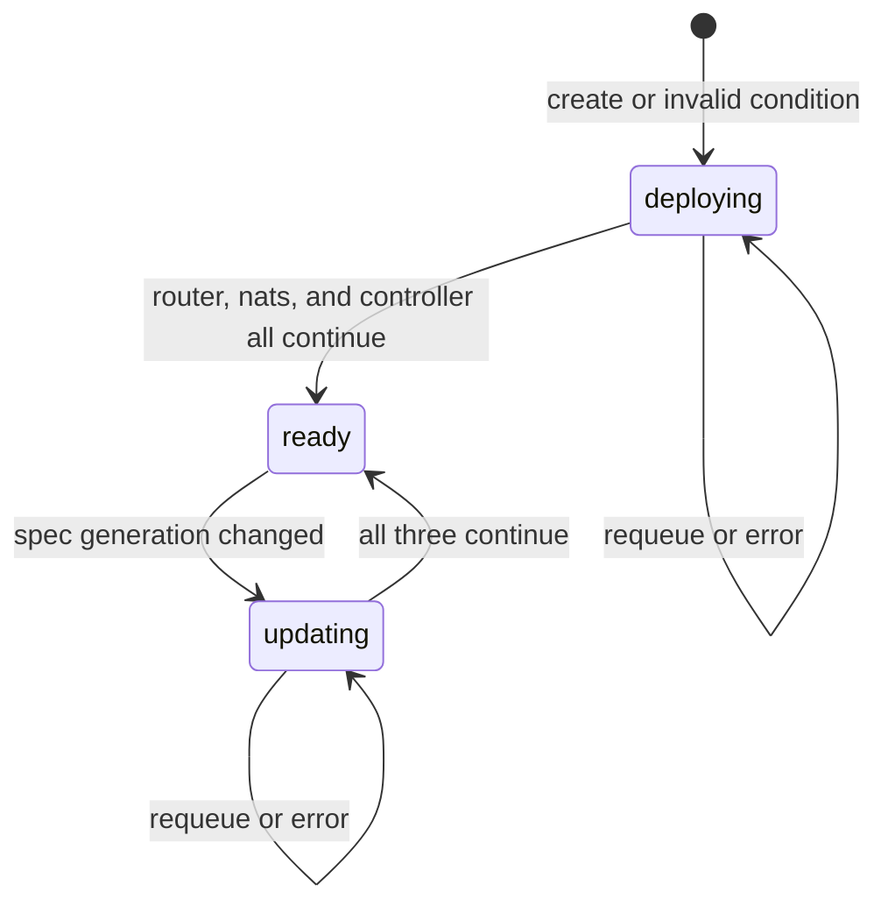

# How the operator works

**potctl** / **iofogctl** installs the ioFog operator, then applies one **`ControlPlane`** custom resource. The operator is a Kubernetes controller that watches that CR and creates the control-plane workloads in the CR’s namespace: **Controller** Deployment, **Router** Deployment, and (unless disabled) **NATS** StatefulSet, plus Services, Secrets, ConfigMaps, RBAC, an optional Ingress, and an optional SQLite PVC.

It does **not** deploy edge applications, agents, or microservices. Those are created with the CLI against the Controller API after the control plane is **ready**.

| You author | Operator watches |
|------------|------------------|
| `kind: KubernetesControlPlane` | Translated CR: name **`pot`** (Datasance) or **`iofog`** (Eclipse) |

Field reference: [schema.md](schema.md). Hub router and NATS objects: [networking.md](networking.md). TLS: [securing-cluster.md](securing-cluster.md).

## Process

The operator process starts a controller-runtime manager:

| Setting | Behavior |
|---------|----------|
| API types | Kubernetes core types plus **`ControlPlane`** / **`ControlPlaneList`** |
| Watch | **`WATCH_NAMESPACE`**. Empty means cluster scope. A non-empty value limits the cache to that namespace |
| Leader election | Off unless **`--enable-leader-election`**. ID `iofog.operator` |
| Controllers | One: **`ControlPlaneReconciler`**, registered with **`For(&ControlPlane{})`** only |

It does **not** watch Deployments, Secrets, or Services as secondary resources. A reconcile runs when:

- a ControlPlane is created, updated, or deleted
- the reconciler **requeues** itself (LoadBalancer not ready, Controller API not up yet, NATS hub registration retry)

Owned objects are garbage-collected when the ControlPlane is deleted (owner references). There is no extra finalizer.

While status says **ready**, the operator returns immediately and does not recreate workloads. The next spec change bumps **`metadata.generation`**. The following reconcile treats the object as **updating** and runs the full deploy path again.

Editing a Secret directly, without changing the ControlPlane, does **not** schedule a reconcile. Change the CR (or redeploy YAML) when the operator must run again.

## Status machine

`status.conditions` keeps one condition **True**. The type is **`deploying`**, **`updating`**, or **`ready`**.

If the ready condition’s **`observedGeneration`** is not the object’s current generation, the effective state is **updating** even before status is rewritten.

**`deploying`** and **`updating`** run the same three functions in parallel:

1. **`reconcileRouter`**
2. **`reconcileNats`** (returns immediately when NATS is disabled)
3. **`reconcileIofogController`**

| Any routine returns | Operator does |
|---------------------|----------------|
| Error | Requeue with that error |
| Requeue | Wait the longest requested delay, then reconcile again |
| All continue | Set condition **ready** |

A ControlPlane can stay in **`deploying`** while a cloud LoadBalancer has no address yet. That wait is expected when operator logs show requeue rather than a hard error. **potctl deploy** waits until the CR reports **ready**.

## What Controller reconcile creates

All names are in the ControlPlane namespace. Labels include `app.kubernetes.io/name: iofog`, `app.kubernetes.io/instance: <metadata.name>`, `app.kubernetes.io/component: controller`, `app.kubernetes.io/managed-by: iofog-operator`.

| Kind | Name | When |
|------|------|------|
| ServiceAccount, Role, RoleBinding | `controller` | Always |
| Secret | `controller-db-credentials` | Always (updated if it already exists) |
| Secret | `controller-auth-credentials` | Always (updated if it already exists) |
| Secret | `controller-vault-credentials` | When `spec.vault` is configured |
| Service | `controller` | Always |
| Ingress | `controller` | When `spec.services.controller.type` is **ClusterIP** |
| PVC | `controller-sqlite` | When `spec.database.host` is empty |
| Deployment | `controller` | Always |

The Controller Role lets the **pod** manage ConfigMaps and Services, read Secrets, and patch the StatefulSet named **`nats`**. That is how the Controller process (not the operator) can adjust NATS after bootstrap.

Pod security context is UID/GID/fsGroup **10000**. Replicas default to **1**. More than one replica needs an external database; SQLite uses a recreate strategy and a single PVC.

| Port name | Service port | Pod port |
|-----------|--------------|----------|
| `controller-api` | **51121** | 51121 |
| `console` | **80** | `spec.controller.consolePort`, default **8008** |

Service type defaults to **LoadBalancer** when `spec.services.controller.type` is empty.

Database passwords and OIDC secrets are written to Secrets and referenced from env, not passed as plain values. See [schema.md](schema.md) for the YAML that the CLI translates into those fields.

### Public URL before the pod is created

When **`controller.publicUrl`** is empty:

| Exposure | Derived `CONTROLLER_PUBLIC_URL` |
|----------|----------------------------------|
| ClusterIP and `ingresses.controller.host` set | `https://<host>` if controller HTTPS or ingress TLS secret is set; otherwise `http://<host>` |
| LoadBalancer and the Service already has an address | `{http\|https}://<lb>:51121` |
| LoadBalancer, no address yet | Requeue **10 seconds**. The Deployment is not created on that pass |

If you set **`controller.publicUrl`** in YAML, the operator uses it and does not wait for a LoadBalancer address.

## Controller reconcile sequence

During **`deploying`** and **`updating`**:

1. Resolve embedded bootstrap password (Secret ref or inline). External auth does not use this step.
2. Create RBAC, credential Secrets, Service `controller`, and Ingress when the Service is ClusterIP.
3. Apply SQLite PVC (if used) and the Controller Deployment. A **new** Deployment requeues **5 seconds** before API calls.
4. `GET` in-cluster `controller.<namespace>.svc.cluster.local:51121/api/v3/status` (HTTPS only when `controller.https` is true).
5. Login (embedded bootstrap user, or external client credentials).
6. **`PUT` default router**, **`PUT` NATS hub** when enabled, **import CA Secrets** as `type: k8s-secret`. Details: [networking.md](networking.md).
7. Check external LoadBalancer or Ingress reachability.
8. If DB, auth, or vault Secrets **already existed** and were updated, restart controller pods so they pick up new Secret data.

Router and NATS workloads are created by the other two routines in parallel. They can exist before registration finishes. Edge agents use the addresses stored in the Controller **after** registration succeeds.

## Ordering on first install

1. Router creates its Service and waits for an address, then writes TLS Secrets and the Deployment.
2. Controller creates its Deployment and requeues. In parallel, NATS calls **`GET /api/v3/nats/bootstrap`** and requeues until that API responds.
3. Later passes: Controller logs in, registers the router, registers the NATS hub, imports CAs. NATS writes `server.conf` and the StatefulSet once bootstrap succeeds.
4. When none of the three asks to requeue, status becomes **ready**.

## What a spec change does

1. You change the ControlPlane spec (redeploy YAML). **`metadata.generation`** increases.
2. Effective state becomes **updating**.
3. Router, NATS, and Controller reconcile again.
4. Controller Deployment is updated. DB, auth, and vault Secrets are overwritten from the spec. Router TLS Secrets are **not** regenerated if they already exist. NATS **`server.conf` is rewritten**.
5. Status returns to **ready** with the new **`observedGeneration`**.

## Related documents

- [README.md](README.md) — CLI deploy sequence
- [networking.md](networking.md) — default router and NATS hub
- [schema.md](schema.md) — `KubernetesControlPlane` fields
- [securing-cluster.md](securing-cluster.md)
