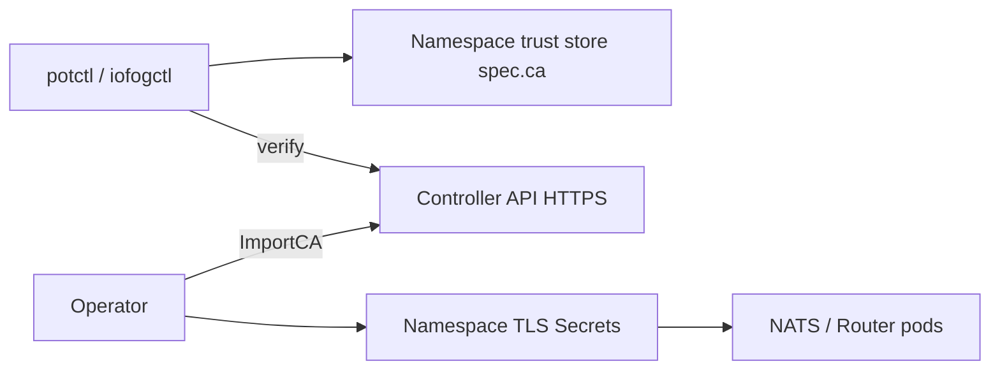

# Securing the Kubernetes control plane

This guide is for authors of **`KubernetesControlPlane`** YAML using **potctl** or **iofogctl**. Cluster TLS for Controller, Router, and NATS is implemented by the **ioFog operator**. This document ties CLI fields to that behavior and explains **CLI-side trust** for the Controller API.

For exhaustive operator detail (Patterns A / B1 / B2, Secret names, cert-manager, Router/NATS generation), use the upstream guide:

- [Securing the cluster (operator)](https://github.com/eclipse-iofog/iofog-operator/blob/main/docs/controlplane/securing-cluster.md)
- [ControlPlane CRD reference (operator)](https://github.com/eclipse-iofog/iofog-operator/blob/main/docs/controlplane/controlplane-crd.md)

## Security model at a glance



| Concern | Where configured | Who creates certs |
|---------|------------------|-------------------|
| Controller HTTPS (LB + pod TLS) | CR `spec.controller.https`, `secretName`, `services.controller` | **You** (TLS Secret in CP namespace) |
| Controller HTTPS (Ingress B1) | ClusterIP + Ingress TLS, `controller.https: false` | **You** or cert-manager on Ingress |
| Controller HTTPS (Ingress B2) | ClusterIP + Ingress + `controller.https: true`, shared or pod Secret | **You** — often one Secret for Ingress and pod |
| Router / NATS mTLS | Operator in CP namespace | Operator (default) or **you** (pre-created Secrets) |
| potctl → Controller API trust | **`spec.ca`** in KubernetesControlPlane YAML | **You** (base64 PEM) |
| External database TLS | CR `spec.database.ssl`, `spec.database.ca` | **You** (base64 PEM on CR) |

There are **no** `routerSiteCA` / `natsSiteCA` fields on `KubernetesControlPlane`. Router and NATS material is entirely operator-managed in the cluster.

## CLI trust: `spec.ca`

| Field | Format | Purpose |
|-------|--------|---------|
| `spec.ca` | Base64-encoded **PEM** (single line) | Trust anchor when the CLI calls the Controller API over HTTPS |

On deploy, the CLI decodes and stores PEM under `~/.iofog/v3/trust/<namespace>/ca.pem`. Subsequent commands in that namespace verify the Controller certificate against that CA when probing the API.

**Encoding (macOS):**

```bash
base64 -i my-ca.pem | tr -d '\n'
```

**Not the same as:**

- Router/NATS Secrets in the cluster (`router-site-ca`, …)
- `spec.controller.secretName` (Controller pod TLS)
- Ingress TLS Secrets

### `connect --ca`

`connect --ca <file>` or base64 override applies at **connect time** only. Namespace trust from `spec.ca` at deploy is the long-lived default for that ECN namespace.

### HTTPS without `spec.ca`

If the Controller presents a public CA–signed certificate, the CLI may trust the system store. For private CAs, always set `spec.ca` at deploy (or use `connect --ca`).

## Controller HTTPS (operator)

Configure via translated CR fields in your **`KubernetesControlPlane`** YAML (same fields on the operator **`ControlPlane`** CR).

| Pattern | `services.controller` | Ingress | `controller.https` | Public certificate | Traffic |
|---------|------------------------|---------|--------------------|--------------------|---------|
| **A** | LoadBalancer | — | `true` | Pod Secret `secretName` | Client → LB → **TLS on pod** |
| **B1** | ClusterIP | Yes | `false` | Ingress `ingresses.controller.secretName` | Client → **TLS on Ingress** → HTTP to pod |
| **B2** | ClusterIP | Yes | `true` | Ingress Secret **and** pod mount (often **same Secret name**) | Client → TLS on Ingress → **TLS to pod** (re-encrypt) |

The CLI **requires** `ingresses.controller.host` and `secretName` when controller Service type is **ClusterIP**. The operator creates Ingress resource **`controller`** (paths `/` → console, `/api/v3` → API port 51121).

Examples: [ingress.yaml](examples/ingress.yaml) (B1), [controller-ingress.yaml](examples/controller-ingress.yaml) (B2, shared Secret).

### Pattern A — LoadBalancer + pod TLS

```yaml
spec:
  services:
    controller:
      type: LoadBalancer
  controller:
    https: true
    secretName: controller-api-tls
    publicUrl: https://203.0.113.10:51121
```

Create `kubernetes.io/tls` Secret **`controller-api-tls`** in the same namespace as the ControlPlane CR before or after apply. See operator doc [Pattern A](https://github.com/eclipse-iofog/iofog-operator/blob/main/docs/controlplane/securing-cluster.md#pattern-a-loadbalancer--pod-tls).

If **`publicUrl`** is omitted, the operator waits for the LoadBalancer address and derives URLs (see [URL resolution](#publicurl-and-consoleurl-operator) below).

### Pattern B1 — Ingress terminates TLS, Controller speaks HTTP

Typical production setup when the ingress controller holds the public certificate.

```yaml
spec:
  services:
    controller:
      type: ClusterIP
  ingresses:
    controller:
      host: controller.example.com
      ingressClassName: nginx
      secretName: controller-tls
  controller:
    publicUrl: https://controller.example.com
    trustProxy: true
    https: false
```

No `controller.secretName` while `https` is false. See operator [B1](https://github.com/eclipse-iofog/iofog-operator/blob/main/docs/controlplane/securing-cluster.md#b1--ingress-terminates-tls-controller-speaks-http).

### Pattern B2 — Ingress + pod TLS (re-encrypt, shared Secret)

Use when both the Ingress and the Controller pod must speak HTTPS. A common approach is **one** TLS Secret referenced by the Ingress **and** mounted on the pod:

- `ingresses.controller.secretName: controller-tls`
- `controller.https: true`
- `controller.secretName: controller-tls` (**same name** as Ingress)

The Ingress must connect to the backend over HTTPS (for nginx):

```yaml
spec:
  services:
    controller:
      type: ClusterIP
  ingresses:
    controller:
      host: controller.example.com
      ingressClassName: nginx
      secretName: controller-tls
      annotations:
        cert-manager.io/cluster-issuer: letsencrypt-prod
        nginx.ingress.kubernetes.io/backend-protocol: "HTTPS"
  controller:
    publicUrl: https://controller.example.com
    trustProxy: true
    https: true
    secretName: controller-tls
```

Clients still use `https://controller.example.com`. Path: **Client → TLS → Ingress → TLS → Controller pod**. The cert in the shared Secret must be valid for the Ingress backend trust model (same SAN, or a chain the ingress controller accepts).

See operator [B2](https://github.com/eclipse-iofog/iofog-operator/blob/main/docs/controlplane/securing-cluster.md#b2--ingress-terminates-tls-and-controller-also-uses-https-re-encrypt).

### `spec.ca` for Ingress patterns (B1 / B2)

Set **`spec.ca`** to the CA that validates the certificate **clients and the CLI actually see** (usually the Ingress public chain or your corporate root), not only an internal pod CA.

### `publicUrl` and `consoleUrl` (operator)

These map from `spec.controller` on your deploy YAML. If omitted, the **operator derives** them when reconciling the ControlPlane CR (then sets `CONTROLLER_PUBLIC_URL` and `CONSOLE_URL` on the Controller pod). Full reference: [operator CRD — URL resolution](https://github.com/eclipse-iofog/iofog-operator/blob/main/docs/controlplane/controlplane-crd.md#url-resolution-publicurl-and-consoleurl).

1. **`publicUrl` set, `consoleUrl` empty** → operator sets **`consoleUrl = publicUrl`**.

2. **Ingress mode** (`services.controller.type: ClusterIP` and non-empty `ingresses.controller.host`):
   - **`publicUrl` empty** → `https://<host>` if `ingresses.controller.secretName` is set, otherwise `http://<host>` (public HTTPS at Ingress is possible even when the pod uses HTTP in B1).
   - **`trustProxy` unset** → operator defaults **`trustProxy: true`**.

3. **LoadBalancer mode** (default controller Service type when not ClusterIP, **`publicUrl` empty**):
   - Waits for LoadBalancer hostname or IP.
   - Sets **`publicUrl`** to `{scheme}://<lb>:51121` and **`consoleUrl`** to `{scheme}://<lb>` (console Service port 80 → pod `consolePort`, default 8008).

**Scheme when URLs are derived**

| Condition | Scheme |
|-----------|--------|
| `controller.https: true` | `https` |
| Ingress mode and `ingresses.controller.secretName` set | `https` (even if pod speaks HTTP in B1) |
| Otherwise | `http` |

**Notes for potctl / iofogctl**

- You may omit **`publicUrl`** and rely on operator derivation after the Ingress or LoadBalancer is ready; the CLI still waits for the ControlPlane to become ready and resolves the API endpoint from LB status, Ingress **`controller`**, or explicit URL.
- Explicit **`publicUrl`** / **`consoleUrl`** are recommended when DNS, TLS termination, or **`:51121`** in the API URL must match what users and **`spec.ca`** expect.
- Set **`consoleUrl`** separately when the Console hostname differs from the API; otherwise leaving it empty copies **`publicUrl`**.

## Database TLS

When using an external database on the CR:

| Field | Controller env (via operator) |
|-------|-------------------------------|
| `database.ssl` | `DB_USE_SSL` |
| `database.ca` | `DB_SSL_CA` — base64-encoded PEM, passed through unchanged |

See [Database TLS and ca (operator CRD)](https://github.com/eclipse-iofog/iofog-operator/blob/main/docs/controlplane/controlplane-crd.md#database-tls-and-ca).

## Router and NATS (operator)

Secret names the operator uses (same namespace as ControlPlane CR):

| Component | Secrets |
|-----------|---------|
| Router | `router-site-ca`, `default-router-local-ca`, `router-site-server`, `router-local-server` |
| NATS | `nats-site-ca`, `default-nats-local-ca`, `nats-site-server`, `nats-mqtt-server` |

The operator imports site/local CAs into the Controller certificate catalog so edges and tools can trust messaging TLS. Details: [Router TLS](https://github.com/eclipse-iofog/iofog-operator/blob/main/docs/controlplane/securing-cluster.md#router-tls-secrets), [NATS TLS](https://github.com/eclipse-iofog/iofog-operator/blob/main/docs/controlplane/securing-cluster.md#nats-tls-secrets).

**Exposure:** Router needs LoadBalancer **or** `ingresses.router.address`. NATS needs LB or `ingresses.nats.address` when not using LoadBalancer for client Service.

## Operational checklist

### Controller

- [ ] Choose Pattern **A**, **B1**, or **B2**; set or verify `controller.publicUrl` / `consoleUrl` (explicit or operator-derived).
- [ ] For Ingress (B1/B2), use `trustProxy: true` (or omit — operator defaults true in Ingress mode).
- [ ] For **B2**, align `ingresses.controller.secretName` and `controller.secretName`; set Ingress `backend-protocol: HTTPS` where required.
- [ ] Set **`spec.ca`** in KubernetesControlPlane for private Controller API CAs.
- [ ] Prefer Kubernetes Secrets for bootstrap passwords in production; inline bootstrap in YAML is for dev only.

### Router / NATS

- [ ] Decide operator-generated vs bring-your-own CA Secrets.
- [ ] Ensure external hostnames in cert SANs match what edges use.

### Namespace hygiene

- [ ] Restrict RBAC on the control plane namespace (Secrets hold DB, auth, and keys).
- [ ] Do not commit manifests with plaintext `database.password` or bootstrap passwords to Git.

## Troubleshooting

| Symptom | Likely cause |
|---------|----------------|
| CLI cannot connect after deploy | Missing or wrong `spec.ca`; mismatch with actual API certificate |
| Deploy validation: Ingress required | `services.controller.type: ClusterIP` without `ingresses.controller.host` / `secretName` |
| Deploy validation: Router ingress | `services.router.type: ClusterIP` without full `ingresses.router` ports |
| Controller stuck not ready (Ingress mode) | Ingress has no external address in status (depends on ingress controller) |
| 502 / SSL errors with B2 | Missing `backend-protocol: HTTPS`; pod Secret name mismatch; Ingress does not trust pod cert |
| OIDC or redirect HTTP/HTTPS mismatch | `publicUrl` scheme vs actual entrypoint; set `trustProxy` in Ingress mode |
| NATS hub not registered | NATS enabled but no LB address and empty `ingresses.nats.address` |
