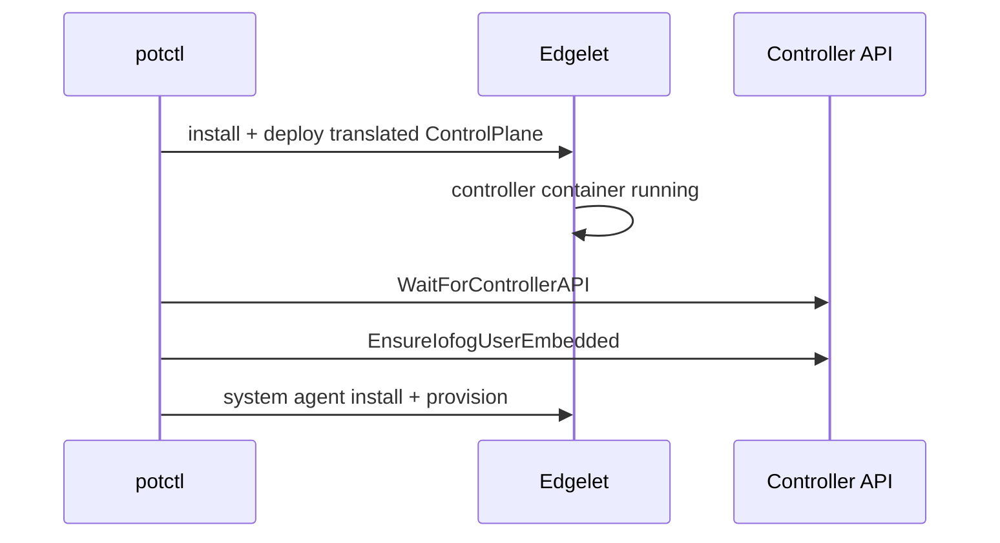

# LocalControlPlane schema

Reference for **`kind: LocalControlPlane`** (v3.9.x).

```yaml
apiVersion: datasance.com/v3   # or iofog.org/v3
kind: LocalControlPlane
metadata:
  name: <name>
  namespace: <optional>        # must match CLI -n if set
spec:
  # fields below
```

---

## CLI-only / not in Edgelet manifest

| Field | Type | Required | Description |
|-------|------|----------|-------------|
| `endpoint` | string | No | Stored CLI endpoint; must match `controller.publicUrl` if both set |
| `ca` | base64 PEM | No | CLI trust for Controller API |
| `iofogUser` | object | Yes (`email`) | CLI user; embedded auth bootstrap after deploy |
| `routerSiteCA` | SiteCertificate | No | Validated; **not deployed locally today** |
| `routerLocalCA` | SiteCertificate | No | Same |
| `natsSiteCA` | SiteCertificate | No | Same |
| `natsLocalCA` | SiteCertificate | No | Same |
| `airgap` | bool | No | Offline image/binary staging |

---

## `spec.systemAgent` (required)

| Field | Required | Description |
|-------|----------|-------------|
| `config.arch` | **Yes** | Host architecture for edgelet and system MS images |
| `config.*` | No | Other agent configuration (router/NATS env, deploymentType, etc.) |
| `package` | No | Edgelet package / WASM shims for agent install |
| `scripts` | No | Custom install script layers |

Invalid `arch` values are rejected. WASM + podman combinations follow agent validation rules.

---

## `spec.controller`

Inline **`ControllerConfig`** plus optional private image:

| Field | Type | Notes |
|-------|------|-------|
| `publicUrl` | string | Recommended — `CONTROLLER_PUBLIC_URL` on Edgelet |
| `trustProxy` | bool | |
| `consoleUrl` | string | Console URL (Edgelet does not copy from publicUrl automatically) |
| `consolePort` | int | Default 8008 |
| `logLevel` | string | |
| `package.image` | string | Controller image if not using CLI default |
| `package.registry` | string | Registry hostname for private pull |
| `package.username` | string | Required with registry + password for private registry |
| `package.password` | string | |
| `package.email` | string | Optional |

Private registry: all of **registry, username, password** required when any is set.

Translated to Edgelet `spec.controller.image` and optional registry id.

---

## `spec.auth` (required)

| Field | Type | Required | Notes |
|-------|------|----------|-------|
| `mode` | `embedded` \| `external` | **Yes** | |
| `insecureAllowHttp` | bool | No | Dev only — `AUTH_INSECURE_ALLOW_HTTP` on Controller |
| `insecureAllowBootstrapLog` | bool | No | Dev only |
| `bootstrap.username` | string | Yes if embedded | |
| `bootstrap.password` | string | Yes if embedded | Required **in YAML** at deploy; ≥12 chars, 1 upper, 1 special |
| `issuerUrl` | string | Yes if external | |
| `client.id` | string | Yes if external | |
| `client.secret` | string | Yes if external | |
| `consoleClient` | string | No | |
| `consoleClientEnabled` | bool | No | |
| `rateLimit.*` | object | No | See nested fields below |
| `sessionStore.*` | object | No | |
| `tokenTtl.*` | object | No | |
| `oidcTtl.*` | object | No | |

Translated to Edgelet **`spec.auth`** → Controller container environment. Env mapping: [Edgelet control plane — spec.auth](https://github.com/Datasance/edgelet/blob/main/docs/edgelet/control-plane.md#spec-auth).

| Mode | CLI after deploy |
|------|------------------|
| `embedded` | Bootstrap login; **`EnsureIofogUserEmbedded`** creates **`iofogUser`** if missing |
| `external` | Skips embedded user bootstrap; Controller uses your IdP |

**Retired:** Keycloak-shaped `auth.url`, realm fields.

Optional nested fields:

| Block | Fields |
|-------|--------|
| `rateLimit` | `enabled`, `maxRequestsPerWindow`, `windowMs` |
| `sessionStore` | `type`, `ttlMs`, `secret` |
| `tokenTtl` | `accessTokenTtlSeconds`, `refreshTokenTtlSeconds` |
| `oidcTtl` | `interactionTtlSeconds`, `grantTtlSeconds`, `sessionTtlSeconds`, `idTokenTtlSeconds` |

---

## `spec.database`

Optional external DB. When `provider` is set (`postgres` or `mysql`), **user, host, port, password, databaseName** are required.

| Field | Notes |
|-------|-------|
| `ssl` | DB TLS |
| `ca` | Base64 PEM → `DB_SSL_CA` |

Omit provider for SQLite-style single-controller local default on Edgelet.

---

## `spec.systemMicroservices`

Per-architecture images for Router and NATS system microservices:

```yaml
systemMicroservices:
  router:
    amd64: ghcr.io/datasance/router:3.9.0
    arm64: ghcr.io/datasance/router:3.9.0
    arm: ghcr.io/datasance/router:3.9.0
    riscv64: ghcr.io/datasance/router:3.9.0
  nats:
    amd64: ghcr.io/datasance/nats:2.15.0
    # ...
```

Maps to Edgelet `spec.systemMicroservices` and Controller env `ROUTER_IMAGE_*` / `NATS_IMAGE_*`. See [Edgelet arch mapping](https://github.com/Datasance/edgelet/blob/main/docs/edgelet/control-plane.md#specsystemmicroservices-arch--image-slot).

---

## `spec.nats`

| Field | Notes |
|-------|-------|
| `enabled` | bool — deploy NATS system microservice when true |

No JetStream PVC fields on local YAML (unlike Kubernetes CR); JetStream behavior is on the system microservice image/config.

---

## `spec.events`

Same as operator-aligned `events` block (`auditEnabled`, `retentionDays`, `cleanupInterval`, `captureIpAddress`).

---

## `spec.vault`

Optional Controller vault integration — translated to Edgelet `spec.vault`. **`basePath` is literal** on Edgelet (no `$namespace` expansion — use real namespace in path).

Supported providers: `hashicorp`, `openbao`, `vault`, `aws`, `aws-secrets-manager`, `azure`, `azure-key-vault`, `google`, `google-secret-manager`.

---

## `spec.tls`

Optional Controller listener TLS — see [securing-cluster.md](securing-cluster.md). Translated to Edgelet **`spec.tls.base64`** only.

---

## Deploy flow (developer view)



---

## Example skeleton

See [examples/minimal.yaml](examples/minimal.yaml).
