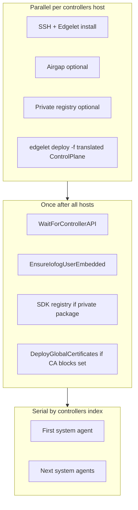

# Remote control plane

Use **`kind: ControlPlane`** (not `RemoteControlPlane`) to deploy a control plane across **one or more SSH-accessible hosts** using **Edgelet**. Global settings (auth, database, images, TLS policy) are declared **once**; each host is listed under **`spec.controllers[]`**.

## When to use

- Bare metal or VM hosts without Kubernetes
- Multi-node layouts with a **default router** and **NATS hub** on the first system agent, and **interior** system agents on additional hosts ([networking](networking.md))
- Production ECNs where you manage SSH, airgap, and corporate CAs explicitly

## High-level orchestration



Details: [multi-controller-ha.md](multi-controller-ha.md).

## Global vs per-host spec

| Scope | Fields |
|-------|--------|
| **Global (once)** | `endpoint`, `ca`, `iofogUser`, `controller`, `database`, `auth`, `routerSiteCA`, `routerLocalCA`, `natsSiteCA`, `natsLocalCA`, `systemMicroservices`, `nats`, `events`, `vault`, `tls`, `airgap` |
| **Per `controllers[]`** | `name`, `host`, `ssh`, **`systemAgent`** (required block), optional `tls` override, optional `airgap` |

Retired: top-level-only `spec.package`, per-controller legacy `https` / `siteCA` / `localCA`.

## Prerequisites

- Passwordless **sudo** on remote hosts (for Edgelet install scripts)
- SSH key access: `ssh.user`, `ssh.keyFile`, optional `ssh.port` (default 22)
- **`spec.controllers[].systemAgent`** block on every controller (may be `{}` — CLI applies defaults when config omitted on remote)
- **`endpoint`** or **`controller.publicUrl`** for API wait and agent configuration

## Deploy

```bash
potctl deploy -f remote-controlplane.yaml -n prod
```

## Persisting spec for add-on controllers

Adding a host later with **`kind: Controller`** requires a **full** remote ControlPlane record in namespace config (includes `auth` and `controller`). Obtain that by:

- Initial **`deploy -f`** with `ControlPlane`, or
- **`connect -f`** with the same full YAML after a manual install

Thin connect (URL only) is **not** enough for add-on deploy.

## Related documents

| Document | Topic |
|----------|--------|
| [networking.md](networking.md) | How the first system agent becomes `default-router` and the NATS hub |
| [schema.md](schema.md) | Field reference |
| [multi-controller-ha.md](multi-controller-ha.md) | Database, ordering, system agents |
| [controller-add-on.md](controller-add-on.md) | `kind: Controller` |
| [securing-cluster.md](securing-cluster.md) | TLS and BYO CAs |
| [examples/](examples/) | Samples |

## Edgelet translation

Same as local: user **`ControlPlane`** / **`LocalControlPlane`** → Edgelet **`edgelet.iofog.org/v1`** **`ControlPlane`**. See [Edgelet control plane](https://github.com/Datasance/edgelet/blob/main/docs/edgelet/control-plane.md).

Per-host translation merges global spec with the matching `controllers[]` entry (e.g. **`controllers[].tls`** overrides global **`spec.tls`** for that host only).
