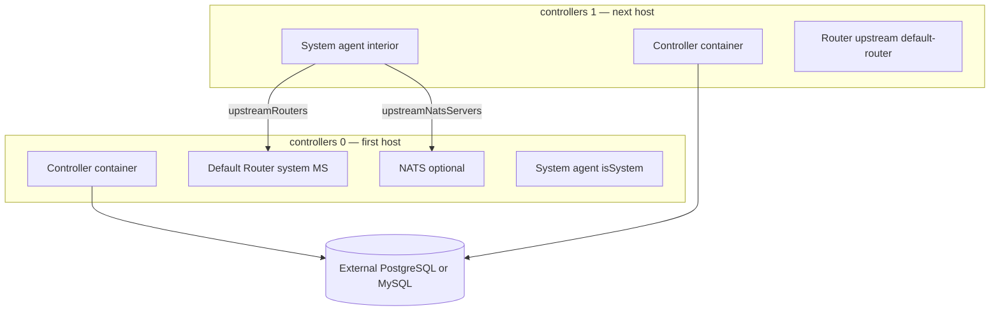

# Multi-controller high availability (remote)

This document explains how **potctl** / **iofogctl** deploy **`kind: ControlPlane`** across **multiple hosts** (v3.9.x): shared configuration, database requirements, parallel Edgelet rollout, global certificate upload, and **serial system agent** roles.

## Architecture

Each entry in **`spec.controllers[]`** is a **physical or VM host** that runs:

1. **Edgelet** (edge runtime),
2. A **Controller container** (from the translated Edgelet ControlPlane manifest — same global auth/database/image spec),
3. A **system agent** (Edgelet) with **`isSystem: true`**, which deploys **Router** and optionally **NATS** as system microservices according to arch images in **`spec.systemMicroservices`**.

This is **not** the Kubernetes operator model (single CR, multiple pod replicas). It is a **multi-node Edgelet** model: **one Controller process per host**, coordinated by a **shared external database** when you run more than one controller host.

## Controller replica count vs database

| `controllers[]` length | Database requirement |
|------------------------|------------------------|
| **1** | **`spec.database`** optional — single Controller may use embedded SQLite on Edgelet |
| **2+** | **`spec.database.provider`** required with **host, port, user, password, databaseName** |

Validation rejects multiple controllers without an external database. The same rule applies when **adding** a controller via **`kind: Controller`** if the stored CP already has one controller and no external DB.

Supported providers: **`postgres`**, **`mysql`**.

All Controller containers must use the **same** database connection settings from global **`spec.database`**. HA and failover semantics depend on Controller and database deployment best practices outside this CLI.

## Endpoint and URLs

| Field | Role |
|-------|------|
| `spec.endpoint` | Primary CLI wait target for Controller API |
| `spec.controller.publicUrl` | Public URL embedded in Edgelet env; must **match** `endpoint` when both are set |
| Per-controller `endpoint` | May be recorded after deploy for that host’s API reachability |

Use HTTPS URLs consistent with **`spec.tls`** and **`spec.ca`**.

## Phase 1 — Parallel per host

For **each** `spec.controllers[]` entry (in parallel):

1. SSH preflight (reachable host, key, user).
2. Edgelet layered install (native/container per system agent config).
3. Airgap validation when **`spec.airgap`** or **`controllers[].airgap`** — requires **`systemAgent.config.arch`** on that controller.
4. Private Edgelet registry manifest when **`spec.controller.package`** has registry + username + password.
5. Translate **global** LocalControlPlane-shaped spec + **this** controller row → Edgelet YAML.
6. **`edgelet deploy -f`** on that host (async apply; CLI polls until running).

No Controller API login happens until **all** hosts complete this phase (or fail).

## Phase 2 — Global once (single ECN namespace)

After every host succeeds and namespace config is flushed:

1. **`WaitForControllerAPI`** against global endpoint / public URL.
2. **`EnsureIofogUserEmbedded`** when **`auth.mode: embedded`** (bootstrap + create **`iofogUser`** if missing).
3. **SDK `CreateRegistry`** when private **`controller.package`** credentials were used (Controller-side pull secret for images).
4. **`DeployGlobalCertificates`** when any of these are set:
   - `routerSiteCA`
   - `routerLocalCA`
   - `natsSiteCA`
   - `natsLocalCA`  

   Creates Controller TLS secrets and CA catalog entries with operator-aligned names (see [securing-cluster.md](securing-cluster.md)). Skipped if all blocks nil.

5. **`BackfillConsoleURL`** on stored CP if needed.

## Phase 3 — Serial system agents (by index)

System agents are deployed **in `controllers[]` order**, not in parallel.

### Index 0 — first system agent

Built with:

- **`isSystem: true`**
- **`upstreamRouters`**: empty list (default router on this node)
- **`upstreamNatsServers`**: empty list (NATS hub on this node when enabled)

This host anchors **`default-router`** and **`default-nats-hub`** for the ECN.

### Index 1, 2, … — next system agents

Built with:

- **`isSystem: true`**
- **`upstreamRouters`**: includes **`default-router`** (appended if you supply a partial list)
- **`upstreamNatsServers`**: includes **`default-nats-hub`**

Interior agents connect messaging to the resources registered on the first host.

### Per-agent steps (each index)

1. Deploy **AgentConfig** to Controller API (SDK).
2. Install/configure Edgelet on that host (already done in phase 1).
3. **`edgelet config --a <controllerUrl>`** and provision with system fog key.
4. Persist agent UUID and SSH metadata in namespace config.

Default when **`systemAgent: {}`**: deployment type native, **`isSystem: true`**, arch may default to **`auto`** on remote when config omitted (airgap excepted — arch then required).

## NATS enabled flag

When **`spec.nats.enabled: true`**, system microservice images under **`systemMicroservices.nats`** must be populated (CLI fills defaults from build tags if omitted). First host runs NATS; later hosts reference **`default-nats-hub`**.

## Airgap

When airgap is enabled globally or on a controller:

- **`systemAgent.config.arch`** is **required** for that controller.
- Images and Edgelet binary are staged from CLI cache before SSH transfer.

## Failure and ordering implications

| Scenario | Behavior |
|----------|----------|
| Host 2 Edgelet deploy fails | Parallel phase fails; global auth/CA/system agents do not run |
| Host 0 system agent fails | Later indices are not provisioned |
| Add second controller without DB | Blocked at validation |
| Duplicate controller `name` or `host` | Blocked at validation |

## Comparison to Kubernetes HA

| Topic | KubernetesControlPlane | Remote ControlPlane |
|-------|------------------------|---------------------|
| Unit of scale | CR **`replicas.controller`**, NATS StatefulSet replicas | **`controllers[]` hosts** |
| Database | CR **`spec.database`** | Global **`spec.database`** |
| Router/NATS TLS | Operator Secrets in namespace | Operator-style CA names via Controller API + system MS on Edgelet |
| Messaging topology | Operator registers default router/NATS hub | First/next system agent upstream lists |

## Related reading

- [schema.md](schema.md) — field definitions
- [controller-add-on.md](controller-add-on.md) — add host without repeating global steps
- [securing-cluster.md](securing-cluster.md) — TLS and CA upload
