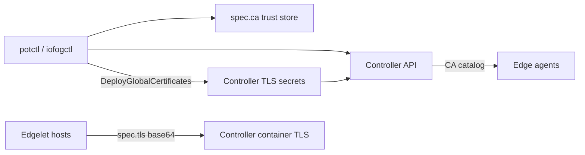

# Securing the remote control plane

Remote **`kind: ControlPlane`** combines **Edgelet** Controller listener TLS, **CLI API trust**, and **bring-your-own** Router/NATS certificate authorities uploaded to the **Controller API** (same secret names as the Kubernetes operator uses in-cluster).

## Security model



| Layer | Configuration | Remote deploy behavior |
|-------|---------------|------------------------|
| CLI → Controller API | `spec.ca` | Stored in namespace trust on deploy |
| Controller HTTPS listener | `spec.tls` or `controllers[].tls` | Translated to Edgelet `spec.tls.base64` per host |
| Router / NATS CAs | `routerSiteCA`, `routerLocalCA`, `natsSiteCA`, `natsLocalCA` | **Once** after API up: create TLS secrets + CA entries |
| Edge agent trust | Controller CA catalog + provision `caCert` | Standard Edgelet provision flow |

Operator reference (cluster Secrets, same names): [iofog-operator securing-cluster](https://github.com/eclipse-iofog/iofog-operator/blob/main/docs/controlplane/securing-cluster.md).

Edgelet listener env mapping: [Edgelet spec.tls](https://github.com/Datasance/edgelet/blob/main/docs/edgelet/control-plane.md#spec-tls).

---

## CLI API trust: `spec.ca`

Base64-encoded PEM. Persisted under `~/.iofog/v3/trust/<namespace>/`. Used for HTTPS verification to **`spec.endpoint`** / **`controller.publicUrl`**.

`connect --ca` overrides at connect time only.

---

## Controller listener TLS: `spec.tls`

Global default for all hosts:

| Field | Required | Notes |
|-------|----------|-------|
| `cert` | Yes* | Server cert PEM (base64) |
| `key` | Yes* | Private key PEM (base64) |
| `ca` | No | Intermediate/root for chain |

\* Cert and key must be supplied together.

**Per-host override:** `controllers[].tls` with the same shape replaces global TLS for **that host’s** Edgelet manifest only (effective TLS: per-controller if set, else global).

Align **`controller.publicUrl`**, **`endpoint`**, and certificate SANs with the hostname or IP edges and operators use.

---

## Bring-your-own Router and NATS CAs

Each block is a **`SiteCertificate`**:

```yaml
routerSiteCA:
  tlsCert: <base64-pem>
  tlsKey: <base64-pem>
```

| YAML block | Secret name | CA catalog name |
|------------|-------------|-----------------|
| `routerSiteCA` | `router-site-ca` | `router-site-ca` |
| `routerLocalCA` | `default-router-local-ca` | `default-router-local-ca` |
| `natsSiteCA` | `nats-site-ca` | `nats-site-ca` |
| `natsLocalCA` | `default-nats-local-ca` | `default-nats-local-ca` |

### Upload semantics (`DeployGlobalCertificates`)

After embedded auth and before **serial system agents**:

1. For each non-nil block, if the Controller has no matching secret, create TLS secret with keys `tls.crt`, `tls.key`, `ca.crt` (CA material from `tlsCert`).
2. If the CA catalog entry is missing, create **`type: direct`** CA pointing at that secret.
3. If both secret and CA already exist, **skip** (idempotent).

**Controller add-on** does **not** re-run this step — plan CA rotation on initial deploy or via Controller API.

These blocks are **not** embedded in Edgelet ControlPlane YAML (Edgelet rejects legacy inline site/local CA fields).

### Operator parity (Kubernetes)

In Kubernetes, the **operator** generates or reuses namespace Secrets with the **same names** and imports CAs into the Controller. On remote Edgelet, **you** supply CA key material in YAML; the CLI registers it with the Controller API instead of kubectl Secrets.

Server certificates for Router/NATS **leaves** are still created by Controller/system microservice deployment logic using those CAs — consult Controller and Router/NATS release notes for rotation.

---

## Database TLS

Global **`spec.database.ssl`** and **`spec.database.ca`** (base64 PEM) translate to Edgelet database env vars on every controller host (`DB_USE_SSL`, `DB_SSL_CA`).

---

## Provision and edge trust

When system agents provision:

1. Controller may return **`caCert`** in the provision key response → CLI runs **`edgelet config cert <base64>`** on that host.
2. Messaging clients use CAs from the Controller catalog (including uploaded site/local CAs).

Ensure **`default-router`** and **`default-nats-hub`** registration on the first host completes before interior agents connect (see [multi-controller-ha.md](multi-controller-ha.md)).

---

## Checklist

### Controller API

- [ ] Set `spec.ca` for private API CAs.
- [ ] Set global or per-host `spec.tls` for HTTPS listener.
- [ ] Match URLs in YAML to certificate SANs.

### Messaging

- [ ] Decide operator-generated (default on first system MS deploy) vs BYO CA blocks in YAML.
- [ ] If BYO, set all four blocks or document which tiers use corporate PKI.
- [ ] Run full **`ControlPlane`** deploy (not add-on) when introducing new global CAs.

### Operations

- [ ] Do not commit YAML with private keys to Git.
- [ ] Restrict SSH and sudo on controller hosts.

---

## Troubleshooting

| Symptom | Likely cause |
|---------|----------------|
| System agent TLS to router fails | CA not in catalog; global CA step skipped or failed |
| Add-on host messaging fails | Interior upstream before first host router ready |
| TLS valid on host 1 but not host 2 | Per-host `controllers[].tls` override missing or wrong |
| Duplicate CA errors | Re-deploy CA blocks after manual partial create — use Controller API to inspect secrets/CAs |
