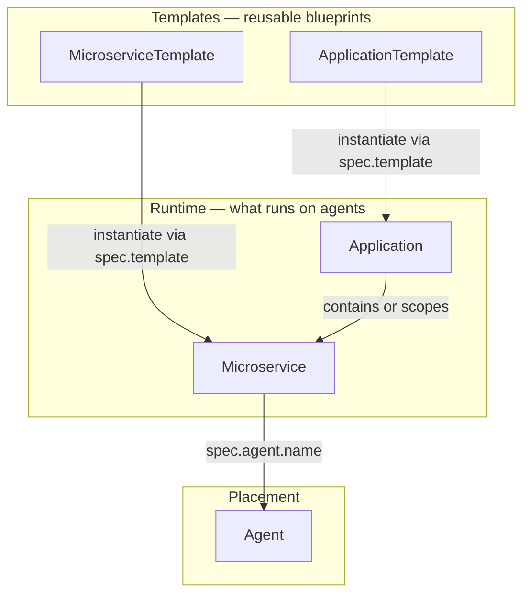

# Workloads (applications and microservices)

Human-written guides for deploying **user workloads** on ioFog / PoT edge networks with **potctl** and **iofogctl**. Workloads live on the **Controller API** — they are not Kubernetes operator CRDs.

Use **`deploy -f`** with multi-document YAML. There is no **`apply`** command.

---

## Taxonomy — how pieces fit together

Think of the edge network in four layers:



| Concept | What it is | Operator mental model |
|---------|------------|------------------------|
| **Application** | A **named app** on the Controller — container for microservices, NATS account policy (`natsConfig`), and optional template instantiation | Like a Kubernetes **namespace** for edge workloads (not a K8s namespace) |
| **Microservice** | One **container workload** on **one agent** — image, ports, env, runtime, fleet catalogs | Like a **Pod** bound to a single node |
| **ApplicationTemplate** | Parameterized **application blueprint** (variables + nested app/ms structure) | Helm chart / cookie-cutter **app** |
| **MicroserviceTemplate** | Parameterized **microservice blueprint** (variables + microservice skeleton) | Cookie-cutter **single service** |

**System applications** (for example `system-<agentName>`) hold **system microservices** the Controller creates from [agent networking config](../agent/networking/README.md) — **`router`**, **`nats`**, **debug exec**, etc. You do not deploy those with user **`kind: Application`** YAML; observe them with **`get system-microservices`** and **`describe system-microservice`**.

**Catalog items** ([catalog-item](../catalog-item/README.md)) supply shared **image sets**; **fleet Model / Knowledge** ([model](../model/README.md), [knowledge](../knowledge/README.md)) bind artifacts into a microservice via **`spec.models`** / **`spec.knowledge`**.

---

## Deploy kinds in this tree

| Kind | Schema | Examples |
|------|--------|----------|
| [ApplicationTemplate](application-template/schema.md) | Blueprint for whole apps | [examples/](application-template/examples/) |
| [MicroserviceTemplate](microservice-template/schema.md) | Blueprint for one service | [examples/](microservice-template/examples/) |
| [Application](application/schema.md) | App + optional inline microservices | [examples/](application/examples/) |
| [Microservice](microservice/schema.md) | Standalone service document | [examples/](microservice/examples/) |

Day-two debugging: [debugging.md](debugging.md) (`logs` / `exec` for microservices and system microservices).

---

## Prerequisites

- Namespace connected to a **Controller** (control plane deployed or `connect`).
- **Agents** provisioned for every `spec.agent.name` you reference.
- **Registry** / **CatalogItem** / fleet resources created **before** microservices that depend on them (see [deploy order](#deploy-order-in-multi-document-yaml)).

---

## Naming microservices

CLI and API use a **fully qualified name** **`application/microservice`** (lowercase alphanumeric):

```bash
potctl describe microservice myapp/api -n my-ecn
potctl logs microservice myapp/api -n my-ecn
```

Standalone **`kind: Microservice`** YAML may set:

- **`metadata.name`**: microservice name only, plus **`spec.application`**, or
- **`metadata.name`**: `myapp/api` (contains `/`).

---

## YAML strictness (important)

| Kind | CLI unmarshaling | Implication |
|------|------------------|-------------|
| **Microservice** | **`yaml.UnmarshalStrict`** | Unknown keys **fail** — typos surface at deploy time |
| **ApplicationTemplate** | non-strict `Unmarshal` | Extra keys may be ignored — prefer valid template fields only |
| **Application** | non-strict spec (`interface{}`) | Flexible; validate with **`describe application`** after deploy |
| **MicroserviceTemplate** | non-strict | Same as application template |

---

## Deploy order in multi-document YAML

The CLI sorts kinds automatically (`kindOrder`). See the full graph in [operator index — ECN resource deploy order](../README.md#ecn-resource-deploy-order).

Workload-focused checklist:

```text
Secret → ConfigMap → Role → RoleBinding → ServiceAccount
→ NatsAccountRule | NatsUserRule
→ … agents … → ApplicationTemplate → MicroserviceTemplate
→ Registry → Model → Knowledge → RuntimeClass → CatalogItem | OfflineImage
→ Application → Microservice → Service
```

Platform & policy kinds: [secret](../secret/README.md), [configmap](../configmap/README.md), [volume](../volume/README.md), [volume-mount](../volume-mount/README.md), [offline-image](../offline-image/README.md), [role](../role/README.md), [nats-account-rule](../nats-account-rule/README.md), [service](../service/README.md).

---

## `deploy -f` flags (workload-related)

| Flag | Applies to | Behavior |
|------|------------|----------|
| **`--patch-model`** | **Microservice-only** YAML file | `PatchMicroserviceModels` — requires **`spec.models`** |
| **`--patch-knowledge`** | **Microservice-only** YAML file | `PatchMicroserviceKnowledge` — requires **`spec.knowledge`** |
| Both patch flags | Same file | Both PATCH calls run (models first) when each section present |
| **`--no-cache`** | OfflineImage kind | Skip caching downloaded images |
| **`--transfer-pool N`** | OfflineImage kind | Concurrent image transfers (default **2**) |

Patch flags **error** if the file contains any non-Microservice kind. Full microservice deploy (no patch flags) uses **`DeployMicroservice`** / YAML upload — Controller decides container **rebuild** rules.

---

## Common commands

```bash
potctl deploy -f workloads.yaml -n my-ecn

potctl get applications -n my-ecn
potctl get microservices -n my-ecn
potctl get system-microservices -n my-ecn

potctl describe application myapp -n my-ecn
potctl describe microservice myapp/api -n my-ecn
potctl describe system-microservice system-edge01/debug -n my-ecn

potctl delete application myapp -n my-ecn
potctl delete microservice myapp/api -n my-ecn
```

Replace `potctl` with `iofogctl` on the Eclipse flavor.

---

## Related operator docs

| Topic | Document |
|-------|----------|
| Agents, fog logs, **`exec agent`** | [agent/debugging.md](../agent/debugging.md) |
| Agent router / NATS fabric | [agent/networking](../agent/networking/README.md) |
| Registry, catalog, fleet | [registry](../registry/README.md), [catalog-item](../catalog-item/README.md), [model](../model/README.md), [knowledge](../knowledge/README.md), [runtime-class](../runtime-class/README.md) |
| RBAC | [Role](../role/README.md), [Role binding](../role-binding/README.md), [Service account](../service-account/README.md) |
| NATS policy rules | [Account rule](../nats-account-rule/README.md) on Application `natsConfig.natsRule`; [user rule](../nats-user-rule/README.md) on Microservice `natsConfig.natsRule` |
| NATS access (runtime) | [nats-access/](nats-access/README.md) — creds mount, env, resolver, lifecycle |
| TCP bridge (`kind: Service`) | [Service](../service/README.md) — microservice/agent/k8s/external backends |
| Secrets / config | [Secret](../secret/README.md), [ConfigMap](../configmap/README.md) |

---

## Mirror flavors

| | **Datasance (potctl)** | **Eclipse (iofogctl)** |
|---|------------------------|-------------------------|
| Deploy YAML `apiVersion` | `datasance.com/v3` | `iofog.org/v3` |
| CLI config directory | `~/.iofog/v3` | `~/.iofog/v3` |

Examples use `datasance.com/v3` and namespace **`my-ecn`**.
